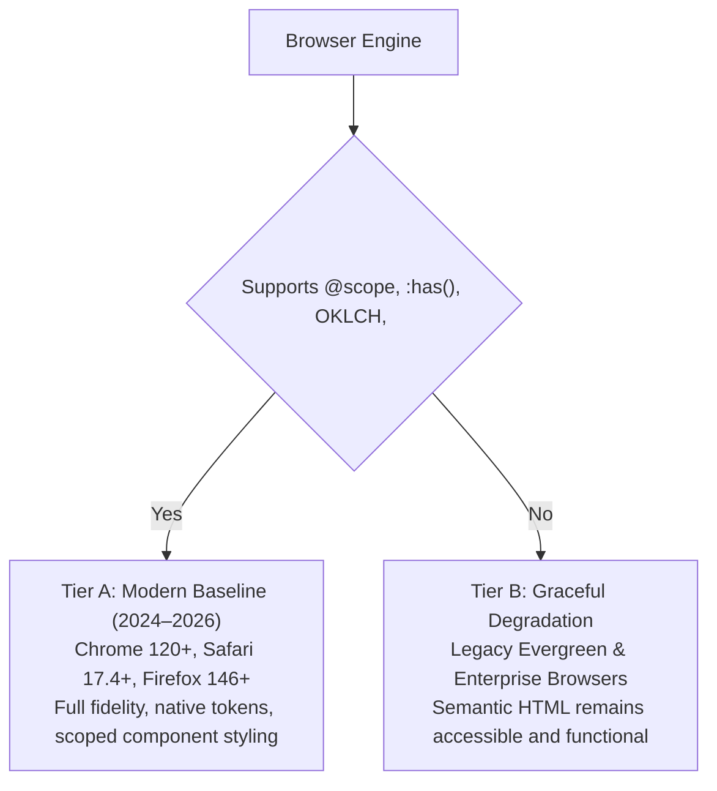
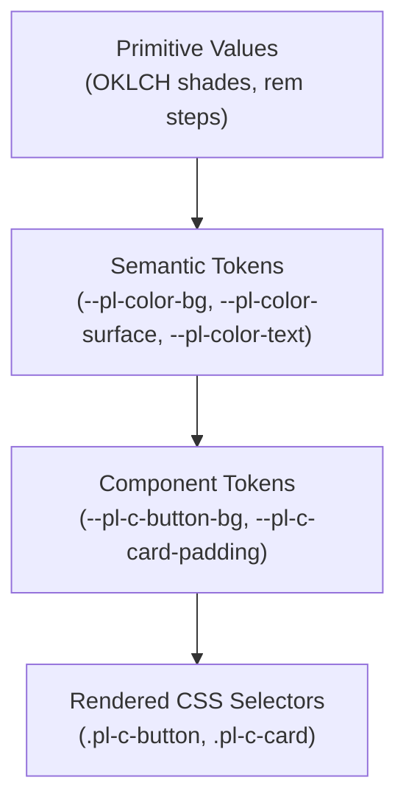

This guide addresses adoption requirements and architectural standards for enterprise applications, upstream platforms, and external design systems integrating `@cawalch/porchlight`.

Porchlight provides a 100% native CSS architecture with zero runtime JavaScript dependencies. This document provides concrete size budgets, verified bundler configurations, complete HTMX recipes, cascade layer integration strategies, and accessibility contracts.

---

## 1. Component Size Budgets & Production Recipes

A common objection when migrating from a custom monolithic stylesheet (often ~14 KB gzip) is that a full framework bundle is ~31 KB gzip. However, **Porchlight is modular by design**: applications should rarely import the monolithic bundle.

### Bundle Sizes (Minified)

Every module is pre-minified with Lightning CSS. Compression measurements below reflect standard Gzip (level 9) and Brotli (level 11):

| Bundle           | File                        | Raw      | Gzip        | Brotli      | Contents & Purpose                                   |
| :--------------- | :-------------------------- | :------- | :---------- | :---------- | :--------------------------------------------------- |
| **Core**         | `dist/core.min.css`         | 8.6 KB   | **2.6 KB**  | **2.2 KB**  | Layers, reset, design tokens, themes, base styles    |
| **Layout**       | `dist/layout.min.css`       | 2.8 KB   | **0.9 KB**  | **0.8 KB**  | Primitives: stack, cluster, grid, sidebar, center    |
| **Utilities**    | `dist/utilities.min.css`    | 2.8 KB   | **0.9 KB**  | **0.7 KB**  | A11y, typography, tabular numbers, flow spacing      |
| **Enhancements** | `dist/enhancements.min.css` | 4.6 KB   | **1.1 KB**  | **0.9 KB**  | Opt-in Progressive Enhancements (`@supports`)        |
| **Experimental** | `dist/experimental.min.css` | 2.1 KB   | **0.6 KB**  | **0.5 KB**  | Bleeding-edge Chrome 133+ `scroll-state()` queries   |
| **Compat**       | `dist/compat.min.css`       | 216.6 KB | **31.1 KB** | **24.7 KB** | All 59 components without experimental syntax        |
| **Full**         | `dist/porchlight.min.css`   | 221.1 KB | **31.8 KB** | **25.2 KB** | Monolithic framework (all components + enhancements) |

### "Core + N Components" Real-World Recipes

When bundled together with your application bundler, duplicate `@layer` headers and design token references compress together. Notice that every practical recipe below ships **between 4.9 KB and 6.8 KB gzip**—**less than half** the size of a legacy 14 KB stylesheet!

| Recipe / Use Case             | Modules & Components Included                                              | Raw     | Gzip       | Brotli     | vs 14 KB Monolith |
| :---------------------------- | :------------------------------------------------------------------------- | :------ | :--------- | :--------- | :---------------- |
| **Minimal Controls**          | `core` + `button` + `field`                                                | 20.7 KB | **4.9 KB** | **4.3 KB** | **-65% smaller**  |
| **SaaS CRUD / Form Admin**    | `core` + `layout` + `button` + `field` + `card` + `badge` + `alert`        | 31.0 KB | **6.8 KB** | **6.0 KB** | **-52% smaller**  |
| **Analytics & KPI Dashboard** | `core` + `layout` + `stat` + `kpi-card` + `badge` + `data-table` + `gauge` | 29.7 KB | **6.4 KB** | **5.6 KB** | **-54% smaller**  |
| **Docs & Marketing Content**  | `core` + `layout` + `card` + `tabs` + `accordion` + `alert` + `code-block` | 27.7 KB | **6.1 KB** | **5.4 KB** | **-56% smaller**  |

```css
/* Example: SaaS CRUD / Form Admin stylesheet (only ~6.8 KB gzip!) */
@layer porchlight, app;

@import "@cawalch/porchlight/core.css";
@import "@cawalch/porchlight/layout.css";
@import "@cawalch/porchlight/components/button.css";
@import "@cawalch/porchlight/components/field.css";
@import "@cawalch/porchlight/components/card.css";
@import "@cawalch/porchlight/components/badge.css";
@import "@cawalch/porchlight/components/alert.css";
```

> [!TIP]
> A complete per-component breakdown for all 59 components is published in [`COMPONENTS.md`](https://github.com/cawalch/porchlight/blob/main/packages/porchlight/COMPONENTS.md) and machine-readable in `@cawalch/porchlight/size-budget.json`.

---

## 2. Bun 1.4.4 Build Support & Toolchain Compatibility

In earlier releases, bundling Porchlight's full stylesheet with Bun failed with:
`error: Unexpected token: scroll-state(`.

### Root Cause & Resolution

Bun's native CSS parser strictly validates CSS Container Queries Level 1 (`@container <name>? (<condition>)`). The bleeding-edge CSS Conditional Rules Level 5 `scroll-state(...)` container function is supported in Chrome 133+, but caused Bun to abort compilation.

Starting in **v0.15.0**:

1. All standard progressive enhancements (`text-box-trim`, gap decorations, typed `attr()`, `@view-transition`, `@starting-style`, etc.) remain in `enhancements.css`.
2. Bleeding-edge `scroll-state(...)` rules are isolated into `@cawalch/porchlight/experimental.css`.
3. Both `porchlight.css` and `full.css` (and their `.min.css` counterparts) build cleanly under `bun build` with **exit code 0**.

### Verified Bun Build Configurations

You can bundle Porchlight directly using Bun:

```sh
# Build application stylesheet using Bun 1.4.4
bun build src/app.css --outdir dist
```

```css
/* src/app.css */
@layer porchlight, app;

/* Import the full bundle or selective modules: */
@import "@cawalch/porchlight/full.css";

@layer app {
  /* Your application overrides */
}
```

If your deployment targets Chrome 133+ and you want zero-JS sticky-header elevation and scroll-overflow indicators, explicitly import the experimental stylesheet in environments with modern parsers (or copy it statically):

```css
@layer porchlight.enhancements;
@import "@cawalch/porchlight/experimental.css";
```

---

## 3. Published (v0.14.0) vs Main (v0.15.0) Diff & API Stability

Porchlight maintains semantic versioning and strict backwards compatibility for all public CSS selectors and design tokens.

### Component Inventory Transition

- **v0.14.0**: Shipped 57 components.
- **v0.15.0**: Ships **59 components**.
  - **New component**: `.pl-c-action-bar` — Pure-CSS floating batch action bar with liquid glass styling and zero-JS reactive auto-reveal via `:has(:checked)`.
  - **New component**: `.pl-c-gauge` — Pure-CSS circular and speedometer KPI dials with registered `@property --pl-gauge-value { syntax: '<percentage>'; }` transitions.

### Key Enhancements & Invariants in v0.15.0

1. **Enterprise SaaS Typography**: Introduced `--pl-text-2xs` (micro-type), proportional negative tracking (`--pl-tracking-tighter`, `--pl-tracking-tight`, `--pl-tracking-wide`), OpenType numeric alignment (`--pl-font-feature-numeric`), and tabular number primitives (`.pl-u-num-tabular`).
2. **Popover Menu Overhaul**: Fixed translucent bleed and contrast degradation. Replaced translucent fills with solid elevated surfaces (`--pl-color-surface`), adjusted active rail indicators to respect high-contrast and dark modes, and eliminated hover latency.
3. **Trigger-Width Anchoring**: Added `anchor-size(self-inline)` matching to `.pl-c-dropdown__menu` and `.pl-c-popover-menu[data-match-trigger]`.
4. **Zero Breaking Changes**: All existing `.pl-c-*`, `.pl-l-*`, and `.pl-u-*` selectors, token names, and markup contracts remain 100% backwards-compatible.

---

## 4. Browser Floor & Fallback Story

Porchlight is built on modern web standards without JavaScript polyfills.

### Support Tiers



### Feature Fallback Matrix

| Modern Capability                            | Primary Use in Porchlight                        | Graceful Fallback (Unsupported Browsers)                                                                                                     |
| :------------------------------------------- | :----------------------------------------------- | :------------------------------------------------------------------------------------------------------------------------------------------- |
| **CSS Anchor Positioning**                   | Menus, calendar popovers, tooltips               | Popovers use fixed/absolute positioning anchored by markup order. Tooltips hide cleanly; essential information remains in accessible markup. |
| **`@starting-style` & Discrete Transitions** | Smooth dialog and drawer backdrop fading         | Modals open and close immediately without transition.                                                                                        |
| **`field-sizing: content`**                  | Auto-expanding textareas and tag inputs          | Control behaves as an ordinary resizable textarea.                                                                                           |
| **`interpolate-size: allow-keywords`**       | Height animation for `<details>` / accordions    | Accordion panel expands/collapses instantly or via CSS grid fallback.                                                                        |
| **`text-box-trim` & `text-box-edge`**        | Cap-height optical alignment for badges/buttons  | Text renders with standard line-box vertical leading.                                                                                        |
| **OpenType Features (`tabular-nums`)**       | Metrics tables and KPI dials                     | Numbers render with proportional glyph widths without breaking layout.                                                                       |
| **`scroll-state()` Container Queries**       | Sticky header shadows and scroll edge indicators | Header stays pinned via `position: sticky`; edge indicators remain invisible.                                                                |
| **CSS Subgrid**                              | Multi-column forms and card decks                | Falls back to standard flex or grid layout without column alignment.                                                                         |

---

## 5. HTMX 4 Production Recipes

Porchlight's markup-first architecture requires no JavaScript controllers to mount or reinitialize after DOM swaps. Below are four production patterns tested with HTMX 2.0+.

### Recipe 1: Inline Table Row Edit, Save & Cancel

This pattern allows users to edit a table row in place without a full-page reload. The server returns the view row or edit row fragment based on HTTP verb.

```html
<!-- View Row Fragment (GET /users/42) -->
<tr id="user-row-42" class="pl-c-table__row">
  <td class="pl-c-table__cell">Jane Doe</td>
  <td class="pl-c-table__cell">jane@example.com</td>
  <td class="pl-c-table__cell pl-u-num-tabular">Admin</td>
  <td class="pl-c-table__cell pl-c-table__cell--action">
    <button
      class="pl-c-button"
      data-variant="ghost"
      data-size="sm"
      type="button"
      hx-get="/users/42/edit"
      hx-target="#user-row-42"
      hx-swap="outerHTML"
    >
      Edit
    </button>
  </td>
</tr>
```

```html
<!-- Edit Row Fragment (GET /users/42/edit) -->
<tr id="user-row-42" class="pl-c-table__row" data-state="editing">
  <td class="pl-c-table__cell">
    <input
      class="pl-c-field__control"
      name="name"
      type="text"
      value="Jane Doe"
      required
    />
  </td>
  <td class="pl-c-table__cell">
    <input
      class="pl-c-field__control"
      name="email"
      type="email"
      value="jane@example.com"
      required
    />
  </td>
  <td class="pl-c-table__cell">
    <select class="pl-c-field__control" name="role">
      <option value="Admin" selected>Admin</option>
      <option value="Editor">Editor</option>
      <option value="Viewer">Viewer</option>
    </select>
  </td>
  <td class="pl-c-table__cell pl-c-table__cell--action">
    <div class="pl-l-cluster" style="--pl-l-cluster-gap: var(--pl-space-1)">
      <button
        class="pl-c-button"
        data-tone="primary"
        data-size="sm"
        type="button"
        hx-put="/users/42"
        hx-include="closest tr"
        hx-target="#user-row-42"
        hx-swap="outerHTML"
      >
        Save
      </button>
      <button
        class="pl-c-button"
        data-variant="plain"
        data-size="sm"
        type="button"
        hx-get="/users/42"
        hx-target="#user-row-42"
        hx-swap="outerHTML"
      >
        Cancel
      </button>
    </div>
  </td>
</tr>
```

---

### Recipe 2: Dynamic Live Filter Builder with Debounced Query

Real-time search facet that updates a results table as the user types, with a native loading indicator.

```html
<form
  class="pl-c-filter-builder pl-l-stack"
  hx-get="/api/audit-logs"
  hx-target="#audit-table-body"
  hx-trigger="input changed delay:250ms, change from:select"
  hx-indicator="#filter-indicator"
>
  <div
    class="pl-l-cluster"
    style="--pl-l-cluster-gap: var(--pl-space-3); align-items: flex-end;"
  >
    <label class="pl-c-field" style="flex: 1; min-inline-size: 14rem;">
      <span class="pl-c-field__label">Search events</span>
      <input
        class="pl-c-field__control"
        name="q"
        type="search"
        placeholder="Filter by actor, IP, or action..."
      />
    </label>

    <label class="pl-c-field" style="min-inline-size: 10rem;">
      <span class="pl-c-field__label">Severity</span>
      <select class="pl-c-field__control" name="severity">
        <option value="">All severities</option>
        <option value="info">Info</option>
        <option value="warning">Warning</option>
        <option value="danger">Critical</option>
      </select>
    </label>

    <!-- Porchlight inline loading primitive revealed via htmx-request -->
    <div
      id="filter-indicator"
      class="pl-c-inline-loading htmx-indicator"
      role="status"
      aria-label="Updating results..."
    >
      <span class="pl-c-inline-loading__spinner"></span>
    </div>
  </div>
</form>

<div class="pl-c-scroll-region pl-c-table-wrap">
  <table class="pl-c-table">
    <thead>
      <tr>
        <th>Timestamp</th>
        <th>Actor</th>
        <th>Event</th>
        <th>Severity</th>
      </tr>
    </thead>
    <tbody id="audit-table-body">
      <!-- Initial server-rendered rows -->
    </tbody>
  </table>
</div>
```

```css
/* Wire HTMX indicator class to Porchlight loading visibility */
.htmx-indicator {
  display: none;
}
.htmx-request .htmx-indicator,
.htmx-request.htmx-indicator {
  display: inline-flex;
}
```

---

### Recipe 3: Infinite Scroll with Native Scroll Trigger

Infinite scroll appending new rows to a table when the sentinel row enters the viewport:

```html
<!-- Table body with sentinel row -->
<tbody id="telemetry-rows">
  <!-- Items 1 to 20 -->
  <tr class="pl-c-table__row">
    ...
  </tr>

  <!-- Sentinel Row (Item 20) -->
  <tr
    class="pl-c-table__row"
    hx-get="/api/telemetry?page=2"
    hx-trigger="revealed"
    hx-swap="afterend"
  >
    <td colspan="4" class="pl-c-table__cell pl-u-text-center">
      <div class="pl-c-inline-loading" role="status">
        <span class="pl-c-inline-loading__spinner"></span>
        <span>Loading older events...</span>
      </div>
    </td>
  </tr>
</tbody>
```

When `/api/telemetry?page=2` returns, it responds with the next batch of rows, followed by a new sentinel row pointing to `page=3` (or omit the sentinel when on the final page).

---

### Recipe 4: Modal Form Drawer with Out-of-Band (OOB) Flash Alerts

A native `<dialog>` drawer that submits a form, closes upon success, and injects an out-of-band flash notification into a global toast container without page reload:

```html
<!-- Global layout container for system toasts -->
<div
  id="system-toasts"
  class="pl-c-toast-shelf"
  aria-live="polite"
  aria-atomic="true"
></div>

<!-- Native Dialog Drawer -->
<dialog
  id="new-api-key-dialog"
  class="pl-c-drawer"
  aria-labelledby="dialog-title"
>
  <div class="pl-c-drawer__panel">
    <header class="pl-c-drawer__header">
      <h2 id="dialog-title" class="pl-c-drawer__title">Create API Token</h2>
      <button
        class="pl-c-button"
        data-variant="ghost"
        type="button"
        onclick="this.closest('dialog').close()"
        aria-label="Close"
      >
        ✕
      </button>
    </header>

    <form
      class="pl-c-form pl-l-stack"
      hx-post="/api/keys"
      hx-target="#key-list-tbody"
      hx-swap="afterbegin"
      hx-on::after-request="if(event.detail.successful) document.getElementById('new-api-key-dialog').close()"
    >
      <label class="pl-c-field">
        <span class="pl-c-field__label">Token name</span>
        <input class="pl-c-field__control" name="name" type="text" required />
      </label>

      <label class="pl-c-field">
        <span class="pl-c-field__label">Expiration</span>
        <select class="pl-c-field__control" name="ttl">
          <option value="30">30 days</option>
          <option value="90">90 days</option>
          <option value="365">1 year</option>
        </select>
      </label>

      <footer class="pl-l-cluster" style="justify-content: flex-end;">
        <button
          class="pl-c-button"
          data-variant="plain"
          type="button"
          onclick="this.closest('dialog').close()"
        >
          Cancel
        </button>
        <button class="pl-c-button" data-tone="primary" type="submit">
          Generate token
        </button>
      </footer>
    </form>
  </div>
</dialog>
```

```html
<!-- Server response (HTTP 201 Created) containing new row + Out-of-Band Toast -->
<!-- 1. Primary Swap (inserted at start of #key-list-tbody) -->
<tr id="key-row-89" class="pl-c-table__row">
  <td class="pl-c-table__cell">Production Worker</td>
  <td class="pl-c-table__cell pl-u-num-tabular">tok_live_7a8f...</td>
  <td class="pl-c-table__cell">
    <span class="pl-c-badge" data-tone="success">Active</span>
  </td>
</tr>

<!-- 2. Out-of-Band Toast swapped into #system-toasts -->
<div id="system-toasts" hx-swap-oob="beforeend">
  <div class="pl-c-toast" data-tone="success" role="status">
    <div class="pl-c-toast__body">
      API token "Production Worker" created successfully.
    </div>
  </div>
</div>
```

---

## 6. Stable `data-*` Hooks & Semantic Tokens Dictionary

Porchlight uses namespaced attributes for framework globals (`data-pl-*`) and clean local attributes for component states.

### Core Attribute Dictionary

| Attribute                        | Scope                          | Supported Values                                                         | Purpose                                                                |
| :------------------------------- | :----------------------------- | :----------------------------------------------------------------------- | :--------------------------------------------------------------------- |
| `data-pl-theme`                  | `<html>`, `<body>`, or subtree | `"light"`, `"dark"`                                                      | Sets color-scheme and drives `light-dark()` OKLCH palette              |
| `data-pl-density`                | Any container or ancestor      | `"compact"`, `"dense"`, `"comfortable"`, `"touch"`                       | Adjusts control heights, cell padding, and typography tracking         |
| `data-tone`                      | Component root                 | `"primary"`, `"neutral"`, `"danger"`, `"success"`, `"warning"`, `"info"` | Contextual semantic palette applied to badges, buttons, alerts, toasts |
| `data-variant`                   | Component root                 | `"solid"`, `"soft"`, `"outline"`, `"plain"`, `"subtle"`, `"ghost"`       | Visual weight and surface treatment                                    |
| `data-size`                      | Component root                 | `"xs"`, `"sm"`, `"md"`, `"lg"`                                           | Control dimensions and scale factor                                    |
| `data-placement`                 | Component root                 | `"top"`, `"bottom"`, `"start"`, `"end"`                                  | Anchor alignment for tooltips, drawers, and popovers                   |
| `data-sticky`                    | Component root                 | `"true"`                                                                 | Enables pinned positioning on banners, toolbars, and table headers     |
| `data-match-trigger`             | Popover menu / dropdown        | Boolean presence                                                         | Matches popover inline width exactly to the trigger's width            |
| `aria-invalid` / `:user-invalid` | Form inputs                    | `"true"`                                                                 | Triggers error borders and displays anchored validation balloons       |

### Semantic Token Hierarchy

Porchlight encapsulates all styles into semantically stable CSS custom properties:



- **Surface & Background**: `--pl-color-bg`, `--pl-color-surface`, `--pl-color-surface-2`, `--pl-color-border`.
- **Typography Scale**: `--pl-text-2xs` (0.65rem–0.72rem), `--pl-text-xs`, `--pl-text-sm`, `--pl-text-md` (1rem), `--pl-text-lg`, `--pl-text-xl`, `--pl-text-2xl`, `--pl-text-3xl`, `--pl-text-display`.
- **Tracking & Numbers**: `--pl-tracking-tighter`, `--pl-tracking-tight`, `--pl-tracking-normal`, `--pl-tracking-wide`, `--pl-font-feature-numeric` (`"tnum" 1, "lnum" 1`).
- **Control Sizing**: `--pl-control-block-size` (32px compact, 40px comfortable, 44px touch, 28px dense), plus `--pl-control-padding-inline` and `--pl-control-gap`.

---

## 7. Cascade Layer & Coexistence Architecture

Porchlight wraps all rules inside cascade layers. This ensures that application styles and third-party frameworks can coexist with **zero specificity wars**.

### Cascade Layer Ordering Contract

Declare your global layer hierarchy at the very top of your application entry:

```css
/* app-entry.css */
@layer reset, vendor, tailwind, porchlight, app, overrides;

/* Import Porchlight */
@import "@cawalch/porchlight/core.css";
@import "@cawalch/porchlight/components/button.css";
@import "@cawalch/porchlight/components/card.css";
```

### Why Layer Ordering Eliminates Specificity Leaks

In CSS Cascade Layers (CSS Cascading and Inheritance Level 5), **layer priority strictly beats selector specificity**:

```css
@layer app {
  /* This single-class selector (specificity 0-1-0) ALWAYS wins over
     complex Porchlight selectors (such as `.pl-c-card > header.pl-c-card__header`)
     because @layer app is declared AFTER @layer porchlight. */
  .custom-card {
    background-color: var(--pl-color-surface-2);
    border-radius: var(--pl-radius-xl);
  }
}
```

### Coexisting with Tailwind CSS, shadcn, or Bootstrap

1. **Tailwind CSS**: Wrap Tailwind in `@layer tailwind`. Tailwind utility classes (`p-4`, `text-red-500`) in `@layer tailwind` can be placed before or after Porchlight depending on whether you want utility classes to override component defaults without `!important`.
2. **CSS Modules**: Author CSS module files as normal. Since local module classes compile into ordinary CSS rules outside `@layer porchlight` (or inside `@layer app`), they will automatically override Porchlight component styles without needing specificity hacks.

---

## 8. Dialog & Popover Architectural Reference

Porchlight leverages the browser's native **Top Layer** APIs for overlays, modals, and dropdowns, eliminating all `z-index` stacking conflicts.

| Feature       | `<dialog class="pl-c-dialog">`               | `<div popover class="pl-c-popover-menu">`          |
| :------------ | :------------------------------------------- | :------------------------------------------------- |
| **API**       | HTML Dialog API (`showModal()`, `close()`)   | HTML Popover API (`popover="auto"` or `"manual"`)  |
| **Modality**  | Modal: traps focus, locks document scrolling | Non-modal or lightweight overlay                   |
| **Backdrop**  | Renders native `::backdrop` scrim            | No backdrop by default (or customizable scrim)     |
| **Dismissal** | Press `Escape` (or backdrop click handler)   | Built-in Light Dismiss (click outside or `Escape`) |
| **Trigger**   | Button with JS or form `method="dialog"`     | Declarative HTML `popovertarget="id"`              |

### Declarative Zero-JS Popover Menu

```html
<!-- Trigger Button tethered to the popover ID -->
<button
  class="pl-c-button"
  type="button"
  popovertarget="user-options-menu"
  aria-haspopup="menu"
>
  Account options
</button>

<!-- Popover Surface in the Top Layer -->
<div
  id="user-options-menu"
  class="pl-c-popover-menu"
  popover="auto"
  role="menu"
>
  <a class="pl-c-popover-menu__item" href="/profile" role="menuitem">Profile</a>
  <a class="pl-c-popover-menu__item" href="/security" role="menuitem"
    >Security</a
  >
  <hr class="pl-c-popover-menu__separator" />
  <button
    class="pl-c-popover-menu__item"
    data-tone="danger"
    type="button"
    role="menuitem"
  >
    Sign out
  </button>
</div>
```

---

## 9. Asset Output for Hashed Embedding & Immutable Caching

When embedding Porchlight into production build pipelines, files should be content-hashed for optimal HTTP caching.

### Bundler Recipes

#### Vite

```js
// vite.config.ts
import { defineConfig } from "vite";

export default defineConfig({
  build: {
    cssTarget: "chrome120",
    rollupOptions: {
      output: {
        assetFileNames: "assets/[name].[hash][extname]",
      },
    },
  },
});
```

#### Webpack / Rspack

```js
// webpack.config.js / rspack.config.js
import MiniCssExtractPlugin from "mini-css-extract-plugin";

export default {
  module: {
    rules: [
      {
        test: /\.css$/,
        use: [MiniCssExtractPlugin.loader, "css-loader"],
      },
    ],
  },
  plugins: [
    new MiniCssExtractPlugin({
      filename: "css/[name].[contenthash:8].css",
    }),
  ],
};
```

#### esbuild CLI

```sh
esbuild src/app.css --bundle --minify --outdir=public/dist --entry-names=[name]-[hash]
```

#### Bun 1.4.4 CLI

```sh
bun build src/app.css --outdir public/dist --asset-naming="[name].[hash].[ext]"
```

### Immutable HTTP Caching Headers

Serve hashed CSS assets with:

```http
Cache-Control: public, max-age=31536000, immutable
```

### Subresource Integrity (SRI)

To generate an SRI hash for static CDN deployment:

```sh
openssl dgst -sha384 -binary dist/porchlight.min.css | openssl base64 -A
```

```html
<link
  rel="stylesheet"
  href="https://cdn.example.com/porchlight.min.css"
  integrity="sha384-..."
  crossorigin="anonymous"
/>
```

---

## 10. High-Density & Scroll-Container SaaS Primitives

Enterprise applications (monitoring dashboards, financial tables, inventory consoles) require high data density and robust scroll ergonomics.

### Activating Density Modes

Set `data-pl-density="compact"` or `data-pl-density="dense"` on any container or table:

```html
<!-- Dense Container -->
<section class="pl-c-card" data-pl-density="compact">
  <div class="pl-c-card__header">
    <h2 class="pl-c-card__title">Audit Stream</h2>
  </div>
  <div class="pl-c-scroll-region pl-c-table-wrap">
    <table class="pl-c-table">
      <thead>
        <tr>
          <th>Transaction ID</th>
          <th>Account</th>
          <th class="pl-u-text-end">Amount</th>
        </tr>
      </thead>
      <tbody>
        <tr>
          <td class="pl-c-table__cell pl-u-text-2xs pl-u-num-tabular">
            tx_9841280
          </td>
          <td class="pl-c-table__cell">Acme Global Holdings</td>
          <td class="pl-c-table__cell pl-u-text-end pl-u-num-tabular">
            $1,450,290.00
          </td>
        </tr>
      </tbody>
    </table>
  </div>
</section>
```

### Essential SaaS Utility Classes

- `.pl-u-num-tabular`: Enforces `font-variant-numeric: tabular-nums` (preventing numbers from shifting during real-time ticker updates).
- `.pl-u-text-2xs`: Micro-typography (0.65rem–0.72rem) designed for timestamps, metadata, and badge labels.
- `.pl-c-scroll-region`: Self-contained scrolling viewport with automatic sticky column and header styling.
- `.pl-l-scroll-container`: Flexible layout wrapper managing viewport boundaries and preventing accidental body scroll.
